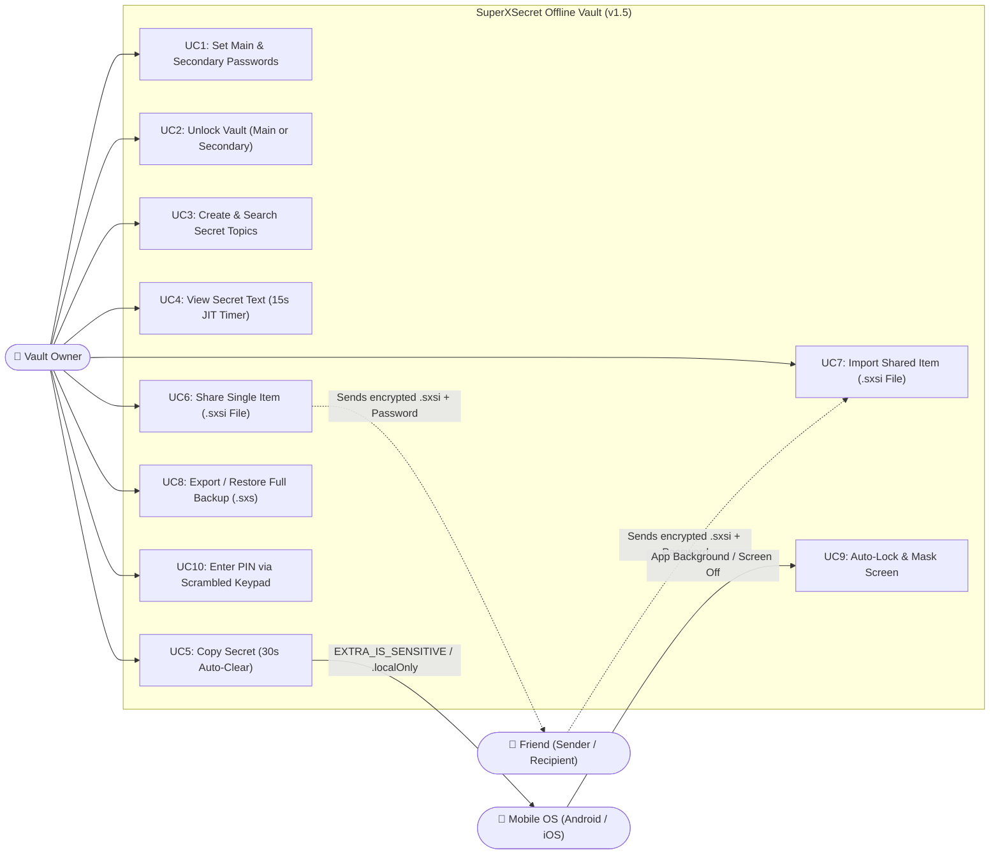
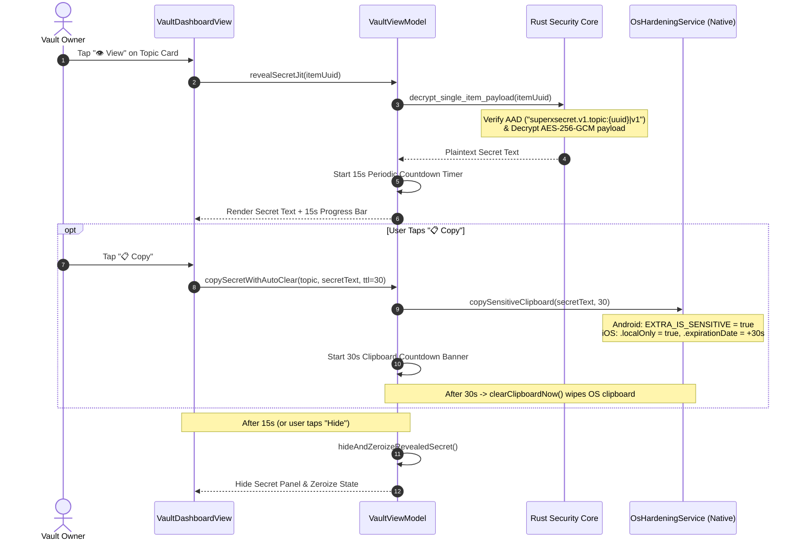
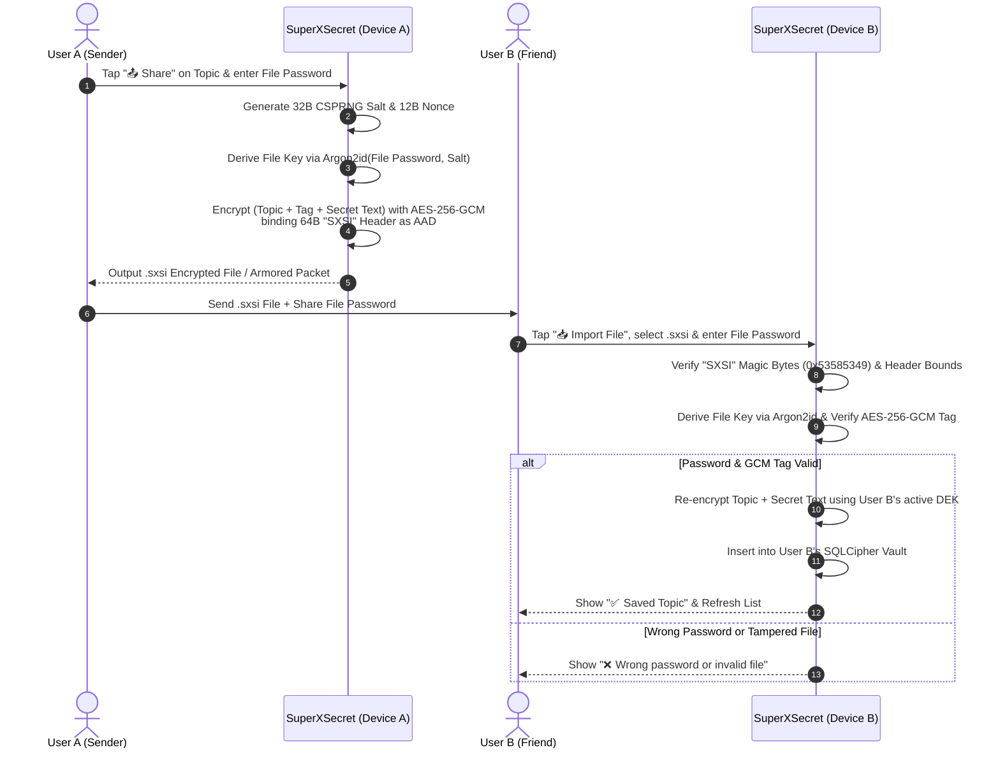
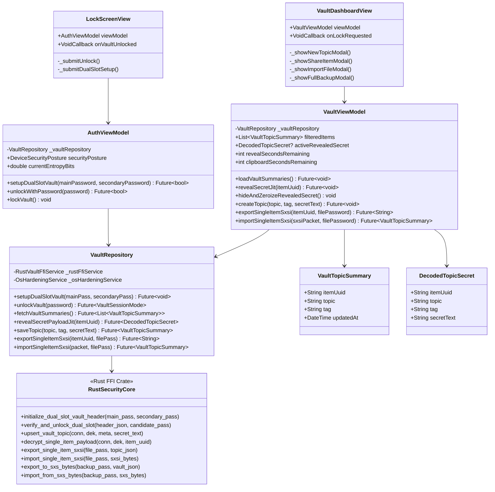
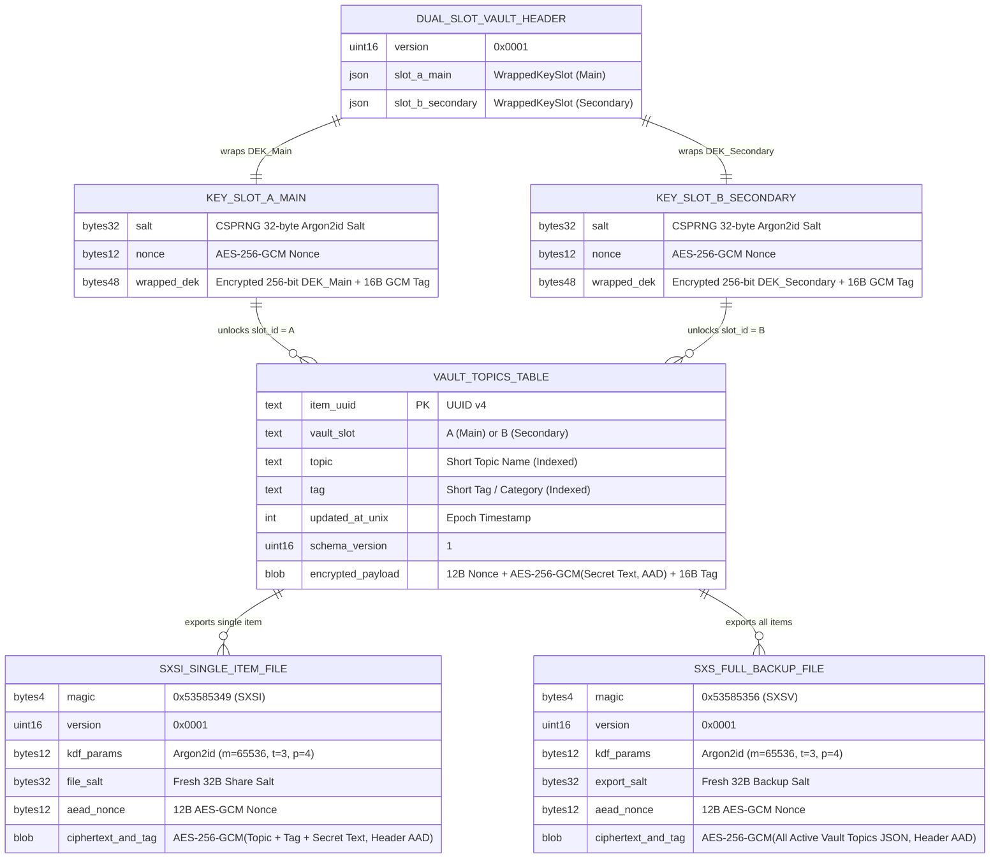

# SuperXSecret (v1.5) — Complete Developer Specification & Architecture Diagrams

> **Target Reader:** Developer Agent (`Flutter + Rust Security Core`)
> **Related Files:** `AGENTS.md`, `ARCHITECTURE.md`

---

## 1. Core Architectural Rules (v1.5 Baseline)

1. **Unified Data Model:** Every vault record is strictly **Topic** + **Secret Text** (`encrypted_payload`). Do NOT use separate Credit Card or Login schemas, and do NOT show category/tag filter buttons (`Email`, `Bank`, `Crypto`) or tag badges.
2. **Dual-Vault Architecture:** Supports **Main Password (`Slot A`)** and **Secondary Password (`Slot B`)**. The unlocked screen must **never** display any `Main`, `Secondary`, or `Fake` badge—both vaults must look 100% identical.
3. **Password-Only & Zero Permissions:** Strictly **0 OS permissions** (no `INTERNET`, no `USE_BIOMETRIC`, no `NSFaceIDUsageDescription`). Keys are derived in RAM via `Argon2id (m=64MB, t=3, p=4)` and never cached in OS Keystore/Keychain.
4. **Short & Simple UI Copy:** Keep all labels, item names, and buttons short (`Unlock`, `Set Passwords`, `New Topic`, `Import File`, `Share`, `View`, `Copy`, `Lock`, `Backup`, `PIN`).
5. **Single-Item Share (`.sxsi`) & Full Backup (`.sxs`):**
   - **`.sxsi` (Magic `"SXSI"` `0x53 0x58 0x53 0x49`):** Encrypts a single `Topic + Secret Text` with a custom **File Password** (`Argon2id` + fresh 32-byte salt + `AES-256-GCM` Header AAD) to share with a friend, and decodes/imports received `.sxsi` files.
   - **`.sxs` (Magic `"SXSV"` `0x53 0x58 0x53 0x56`):** Exports and restores all topics in the active vault.

---

## 2. Software Requirements Specification (SRS)

### 2.1 Functional Requirements (FR)

| ID | Feature | Requirement Description |
| :--- | :--- | :--- |
| **FR-01** | **Dual-Slot Password Setup** | Configure **Main Password (`Slot A`)** and **Secondary Password (`Slot B`)**. Each slot wraps an independent 256-bit `DEK` using `Argon2id (64MB, t=3, p=4)` + `HKDF-SHA256` + `AES-256-GCM`. |
| **FR-02** | **Password-Only Unlock** | Entering a password tests both `Slot A` and `Slot B`. Matching `Slot A` mounts the Main Vault; matching `Slot B` mounts the Secondary Vault with identical UI appearance. |
| **FR-03** | **Topic + Secret Text CRUD** | Create, search (by `Topic` metadata), and view secret items. `Secret Text` is encrypted with `AES-256-GCM` bound to `AAD = superxsecret.v1.topic:{item_uuid}|v1`. |
| **FR-04** | **15s JIT View (Decode)** | Tapping `View` decrypts a single item's `Secret Text` in RAM for **15 seconds**, displaying a live countdown before auto-hiding and zeroizing the memory buffer. |
| **FR-05** | **30s Hardened Clipboard** | Tapping `Copy` writes to the OS clipboard with `EXTRA_IS_SENSITIVE` (Android 13+) / `.localOnly` + `.expirationDate` (iOS) and auto-wipes after **30 seconds**. |
| **FR-06** | **Single-Item Share (`.sxsi`)** | Tapping `Share` on any item prompts for a **File Password** and exports an encrypted `.sxsi` (`"SXSI"` magic) file/packet to send to a friend. |
| **FR-07** | **Single-Item Import (`.sxsi`)** | Tapping `Import File` accepts an encrypted `.sxsi` file/packet and the sender's **File Password**, verifies the `AES-256-GCM` tag, decodes the item, and saves it into the active vault. |
| **FR-08** | **Full Backup & Restore (`.sxs`)** | Tapping `Backup` exports or restores all items in the active vault using the 64-byte `"SXSV"` authenticated header format. |

### 2.2 Non-Functional & Security Requirements (NFR)

| ID | Category | Requirement Specification |
| :--- | :--- | :--- |
| **NFR-01** | **Zero Permissions** | `AndroidManifest.xml` must strip `INTERNET`, `ACCESS_NETWORK_STATE`, and `USE_BIOMETRIC`. `Info.plist` must omit `NSFaceIDUsageDescription` and block ATS loads. |
| **NFR-02** | **RAM Zeroization** | All keys (`DEK`, `KEK`) and decrypted payloads in Rust must use `ZeroizeOnDrop` / `Zeroizing<Vec<u8>>`. |
| **NFR-03** | **Anti-Capture & Auto-Lock** | Enable `FLAG_SECURE` on Android and blur curtain on iOS (`willResignActive`). Immediately lock the vault and wipe `DEK` on backgrounding or `ACTION_SCREEN_OFF`. |
| **NFR-04** | **Incognito Input & PIN Pad** | All `TextField` widgets must set `enableIMEPersonalizedLearning: false`, `autocorrect: false`, `enableSuggestions: false`. Provide an in-app CSPRNG **Scrambled PIN Pad**. |

---

## 3. Use Case Diagram



---

## 4. Sequence Diagrams

### 4.1 Dual-Slot Password Unlock & Identical Vault Mounting

```mermaid
sequenceDiagram
    autonumber
    actor User as Vault Owner
    participant UI as LockScreenView
    participant VM as AuthViewModel
    participant Repo as VaultRepository
    participant Rust as Rust Security Core (FFI)
    participant DB as SQLCipher 4.x

    User->>UI: Enter Password & tap "Unlock"
    UI->>VM: unlockWithPassword(password)
    VM->>Repo: unlockVault(password)
    Repo->>Rust: verify_and_unlock_dual_slot(header_json, password)
    
    Note over Rust: Run Argon2id (64MB, t=3, p=4) + HKDF-SHA256<br/>against Slot A Salt and Slot B Salt
    
    alt Matches Slot A (Main Password)
        Rust->>Rust: Unwrap DEK_Main into Zeroizing<[u8; 32]>
        Rust->>DB: Open Main Partition (PRAGMA key = HKDF(DEK_Main))
        Rust-->>Repo: Ok(VaultSessionMode::MainVault)
    else Matches Slot B (Secondary Password)
        Rust->>Rust: Unwrap DEK_Secondary into Zeroizing<[u8; 32]>
        Rust->>DB: Open Secondary Partition (PRAGMA key = HKDF(DEK_Secondary))
        Rust-->>Repo: Ok(VaultSessionMode::SecondaryVault)
    else GCM Tag Mismatch on Both Slots
        Rust-->>Repo: Err("Wrong password")
        Repo-->>VM: Throw AuthError
        VM-->>UI: Display "❌ Wrong password"
    end

    Repo-->>VM: Unlock Success
    VM-->>UI: Navigate to VaultDashboardView (No Main/Secondary badge shown)
```

### 4.2 15-Second Just-In-Time (JIT) View & 30-Second Clipboard Auto-Wipe



### 4.3 Single-Item Encrypted Share (`.sxsi`) & Friend Import Workflow



---

## 5. Class Diagram (Flutter MVVM + Rust FFI Core)



---

## 6. Entity-Relationship (ER) & Binary Storage Diagram



---

## 7. Step-by-Step Developer Implementation Plan (Sprints 1–4)

### Sprint 1: Rust Security Core Refactoring (`rust_core/`)
- [x] **Task 1.1 — Unified `vault_topics` Schema in SQLCipher (`rust_core/src/vault_db.rs`):**
  - Replace `VaultItemMetadata` with `VaultTopicRecord` (`item_uuid`, `topic`, `tag`, `updated_at_unix`, `schema_version`, `encrypted_payload`).
  - Update `build_record_aad` to `superxsecret.v1.topic:{item_uuid}|v{schema_version}`.
- [x] **Task 1.2 — Implement `.sxsi` Single-Item Encrypted File Codec (`rust_core/src/sxs_backup.rs`):**
  - Add `SXSI_MAGIC` (`[0x53, 0x58, 0x53, 0x49]`, `"SXSI"`) and functions `export_single_item_sxsi_bytes` / `import_single_item_sxsi_bytes`.
- [x] **Task 1.3 — Update FFI Entrypoints (`rust_core/src/api.rs`):**
  - Rename `DuressDecoyVault` to `SecondaryVault` (and `PrimaryVault` to `MainVault`), and expose `create_sxsi_item_share` and `decode_sxsi_item_share`.

### Sprint 2: Flutter Domain & Data Layer Refactoring (`lib/domain/` & `lib/data/`)
- [x] **Task 2.1 — Streamline Domain Models (`lib/domain/models/vault_models.dart`):**
  - Rename `VaultSessionMode` values to `mainVault` and `secondaryVault`.
  - Replace `CreditCardSecretPayload`, `LoginSecretPayload`, and `SecretNotePayload` with unified `VaultTopicSummary` (`itemUuid`, `topic`, `tag`, `updatedAt`) and `DecodedTopicSecret` (`itemUuid`, `topic`, `tag`, `secretText`).
- [x] **Task 2.2 — Update FFI Service & Repository (`lib/data/`):**
  - Update `rust_vault_ffi_service.dart` and `vault_repository.dart` with short sample item names (`ProtonMail`, `KBank Card`, `Crypto Seed` for Main Vault; `Netflix`, `Home Wi-Fi` for Secondary Vault), `createNewTopic`, `exportSingleItemSxsi`, and `importSingleItemSxsi`.

### Sprint 3: Flutter UI Views & Modals (`lib/ui/`)
- [x] **Task 3.1 — Simplify Lock Screen Copy (`lib/ui/features/auth/views/lock_screen_view.dart`):**
  - Use clean, short English labels (`Unlock`, `Set Passwords`, `Main Password`, `Secondary Password`, `Strength`, `Main Vault`, `Secondary Vault`).
- [x] **Task 3.2 — Update Vault Dashboard (`lib/ui/features/vault/`):**
  - Remove any `MAIN` / `FAKE` status badge from the `AppBar` so both vaults look 100% identical.
  - Add `+ New Topic` modal (`Topic Name`, `Tag`, `Secret Text` + `🎲 Gen Pass` button).
  - Add `📤 Share` modal on each topic card to generate an encrypted `.sxsi` packet with a File Password.
  - Add `📥 Import File` modal to decode and save a friend's `.sxsi` packet using the File Password.

### Sprint 4: Automated Testing & Verification (`test/`)
- [x] **Task 4.1 — Update Unit & Architecture Tests (`test/vault_architecture_test.dart`):**
  - Verify Main Vault (`Slot A`) vs. Secondary Vault (`Slot B`) isolation.
  - Verify creating and decoding a unified Topic + Secret Text item.
  - Verify exporting a single item into `.sxsi` with a File Password and decoding/importing it (plus rejecting wrong passwords).
  - Verify full `.sxs` backup `"SXSV"` magic header integrity.


